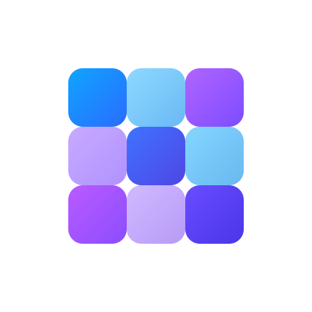

# LinkQuilt

**Your links. Your page. Your corner of the web.**

A free, multi-user link-in-bio platform built for creators, developers, and anyone who wants a customizable home for their links.

**[🌐 Try LinkQuilt](https://linkquilt.com)** · **[🛠 Source code](https://github.com/elliottparedes/LinkQuilt)** · **[🐛 Report an issue](https://github.com/elliottparedes/LinkQuilt/issues)**

---

## What is LinkQuilt?

LinkQuilt helps you collect your links, projects, social profiles, and content in one shareable page.

It started as a fork of [OmniRise/LinkBreeze](https://github.com/OmniRise/LinkBreeze). LinkQuilt builds on that foundation with **multi-user accounts, individual page ownership, permissions, and a hosted experience**. Instead of needing to install a separate app just to make a link page, visitors can use the LinkQuilt service, subject to the instance's registration settings.

The hosted service is intended to be **free to use**. The code is also available for people who prefer to run their own instance.

## ✨ Features

| | |
|---|---|
| **👥 Multi-user accounts** | Separate accounts with owned pages, role-based access, and account administration |
| **🔗 Personal link pages** | Public profiles with custom slugs, social links, sections, link ordering, and optional additional pages |
| **🎨 Themes and customization** | Preset themes, detailed appearance controls, backgrounds, and custom styling |
| **📊 Built-in analytics** | Page views, link clicks, referrers, devices, traffic insights, and date-range reporting |
| **📱 Embeds and sharing** | Rich media embeds, QR codes, social previews, and vCard contact sharing |
| **⏰ Advanced links** | Scheduled links, link thumbnails, custom redirects, and A/B testing |
| **🌐 Custom domains** | Domain-to-page routing, subject to the deployment's DNS and proxy configuration |
| **🔐 Account security** | Password authentication, configurable roles and permissions, TOTP, and optional OIDC single sign-on |
| **📦 Import and export** | Migration tools, data exports, and configurable backups |
| **🛠 Developer tools** | API-key-authenticated REST endpoints with OpenAPI documentation |

Some features depend on the role assigned to an account or on instance-wide settings. Optional integrations, such as wallet passes and external analytics, require additional credentials or configuration.

## 🚀 Get started

### Use the hosted service

1. Visit **[linkquilt.com](https://linkquilt.com)**.
2. Select sign up if registration is enabled. Instance administrators can turn public registration on or off.
3. Create an account and sign in.
4. Customize your page, add links, and share your public URL.

By default, the multi-user application can provision a page for each new account. Administrators may instead configure manual page creation.

### Run your own instance

LinkQuilt can also be deployed as a Dockerized Next.js application. The repository includes a Dockerfile, a general Compose file, and a Dokploy-specific Compose file.

For Dokploy, use **[the deployment guide](docs/dokploy.md)** and **[docker-compose.dokploy.yml](docker-compose.dokploy.yml)**.

For local development:

~~~bash
git clone https://github.com/elliottparedes/LinkQuilt.git
cd LinkQuilt
npm ci
cp .env.example .env
npm run db:migrate
npm run dev
~~~

Open **http://localhost:3000**. On an uninitialized database, the app redirects to its first-run setup.

**Requirements:** Node.js 22 or newer. For production deployments, configure a persistent data directory/volume and the correct public **BASE_URL**. Follow the deployment guide for environment and HTTPS setup.

> **Note:** Some configuration variables, container service names, database file paths, and other internal identifiers retain the original LinkBreeze naming for compatibility. Do not rename them without checking migration and deployment impact.

## 🏗 Architecture

| Layer | Technology |
|---|---|
| Web application | Next.js 16 App Router, React 19, TypeScript |
| UI | Tailwind CSS, Base UI, drag-and-drop components |
| Persistence | SQLite, Drizzle ORM, better-sqlite3 |
| Authentication | Signed sessions, Argon2id password hashing, optional OIDC and TOTP |
| Analytics | Server-side page views and link interactions |
| Containerization | Docker, Docker Compose |
| Production deployment | Dokploy with a persistent Docker volume and HTTPS routing |
| Testing | Vitest and Playwright |

### Multi-user design

LinkQuilt has user accounts and page ownership, rather than treating everyone as a single administrator. Roles determine who can see or manage pages and who can administer accounts or the instance. Administrators can enable or disable signups, create and disable accounts, assign roles, and control whether new users receive pages automatically.

The public page routes and dashboard use page-aware data access, while account-management operations require the appropriate permissions. See the source for the complete implementation and its security boundaries.

### Production storage

The Dokploy Compose configuration builds the application from this repository and mounts a persistent volume at **/app/data**. This holds application state such as the SQLite database and uploaded files. The application runs database migrations as part of its container startup process.

See [Dokploy deployment and backup guidance](docs/dokploy.md) before managing or replacing production volumes.

## 🔌 API

LinkQuilt includes a REST API for links, sections, profiles, and analytics. API access uses keys generated within the application's security settings.

On a running instance:

- **/api/v1/docs** — interactive API documentation
- **/api/v1/openapi.json** — OpenAPI specification
- **/api/health** — health endpoint

Do not share API keys publicly or commit them to the repository.

## 🧪 Development

~~~bash
npm run lint
npm test
npm run test:e2e
npm run build
~~~

The project includes unit, API-contract, and end-to-end test coverage. These commands are provided for contributors; their presence does not assert that a particular CI run or production release has passed.

## 📖 More documentation

- [Dokploy deployment](docs/dokploy.md)
- [Custom domains](docs/custom-domains.md)
- [A/B testing](docs/ab-testing.md)
- [Architecture decisions](docs/adr/)
- [Security](SECURITY.md)
- [Contributing](CONTRIBUTING.md)

## 🤝 Origins and license

LinkQuilt is a fork of **[LinkBreeze by OmniRise](https://github.com/OmniRise/LinkBreeze)**. Credit belongs to the original maintainers and contributors for the foundation that made this project possible. LinkQuilt's hosted, multi-user direction and subsequent changes are maintained in this repository.

Distributed under the [MIT License](LICENSE). Review the included license and attribution notices when redistributing.

---

**[Create your link page at linkquilt.com](https://linkquilt.com)**

